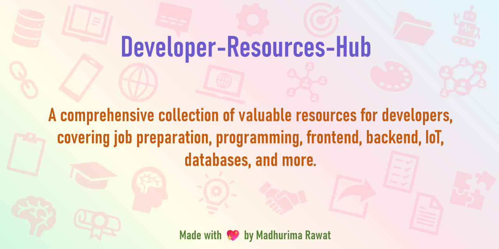
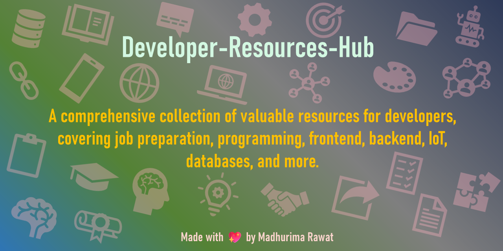

# Developer-Resources-Hub

A comprehensive collection of valuable resources for developers, covering job preparation, programming, frontend, backend, IoT, databases, and more.

<p align="center">
  <a href="https://github.com/madhurimarawat/Developer-Resources-Hub/stargazers">
    
  </a>
  <a href="https://github.com/madhurimarawat/Developer-Resources-Hub/network/members">
    
  </a>
  <a href="https://github.com/madhurimarawat/Developer-Resources-Hub">
    
  </a>
  <a href="https://github.com/madhurimarawat/Developer-Resources-Hub/blob/main/LICENSE">
    
  </a>
  
  
  <a href="https://github.com/madhurimarawat/Developer-Resources-Hub/pulls?q=is%3Apr+is%3Aclosed">
  
</a>
<a href="https://github.com/madhurimarawat/Developer-Resources-Hub/pulls?q=is%3Apr+is%3Aopen">
  
</a>
<a href="https://github.com/madhurimarawat/Developer-Resources-Hub/issues?q=is%3Aissue+is%3Aclosed">
  
</a>
<a href="https://github.com/madhurimarawat/Developer-Resources-Hub/issues">
  
</a>
</p>

It also covers all the little-to-big annoyances you might face, like not being able to find on Google Authenticator, how to delete an account entry, or how to add multiple accounts in whatsapp or email. I keep adding solutions to every small problem or workaround I come across.

> [!TIP]
> You can also open an issue (https://github.com/madhurimarawat/Developer-Resources-Hub/issues) or submit a PR (https://github.com/madhurimarawat/Developer-Resources-Hub/pulls) if you have faced a problem or found a useful workaround.

<p align="center">
<a href="https://github.com/madhurimarawat/Developer-Resources-Hub"></a>
  <a href="https://github.com/madhurimarawat/Developer-Resources-Hub"></a>
</p>

**Developer Resources Hub** brings together well-structured guides, tutorials, and reference materials across key domains in software development:

* 💼 **Job Preparation** - Interview questions, coding challenges, and career-building resources  
* 💻 **Programming** - Language-specific tips, examples, and foundational concepts  
* 🌐 **Frontend & Backend Development** - Framework insights, tooling, and practical workflows  
* 📡 **IoT (Internet of Things)**  Architectures, protocols, and application-level references  
* 🗄️ **Databases** - SQL/NoSQL fundamentals, query optimization, and schema design  

<div align="center">
  
<h3 align="center">🧭 Explore Developer Resources</h3>

<table>
  <tr>
    <td align="center" width="120">
      <a href="#useful-links">
        
        <br>🔗 Useful Links
      </a>
    </td>
    <td align="center" width="120">
      <a href="#recommended-apps">
        
        <br>📱 Notes & Apps
      </a>
    </td>
    <td align="center" width="120">
      <a href="#free-courses">
        
        <br>📚 Free Courses
      </a>
    </td>
    <td align="center" width="120">
      <a href="#books-and-references">
        
        <br>📘 Books
      </a>
    </td>
    <td align="center" width="120">
      <a href="#ai-ml-ds-resources">
        
        <br>🧠 AI / ML / DS
      </a>
    </td>
    <td align="center" width="120">
      <a href="#ai-art-tools">
        
        <br>🎨 AI Art Tools
      </a>
    </td>
  </tr>

  <tr>
    <td align="center">
      <a href="#app-links">
        
        <br>📲 App Links
      </a>
    </td>
    <td align="center">
      <a href="#aptitude--logical-reasoning">
        
        <br>🧠 Aptitude
      </a>
    </td>
    <td align="center">
      <a href="#blockchain">
        
        <br>⛓️ Blockchain
      </a>
    </td>
    <td align="center">
      <a href="#coding-questions">
        
        <br>📘 Coding Questions
      </a>
    </td>
    <td align="center">
      <a href="#custom-gpts">
        
        <br>🤖 Custom GPTs
      </a>
    </td>
    <td align="center">
      <a href="#databases">
        
        <br>🗄️ Databases
      </a>
    </td>
  </tr>

  <tr>
    <td align="center">
      <a href="#ds-resources">
        
        <br>📊 Data Science
      </a>
    </td>
    <td align="center">
      <a href="#full-stack-development">
        
        <br>🧑‍💻 Full Stack
      </a>
    </td>
    <td align="center">
      <a href="#graphic-designing">
        
        <br>🧾 Graphic Design
      </a>
    </td>
    <td align="center">
      <a href="#iot-resources">
        
        <br>📡 IoT
      </a>
    </td>
    <td align="center">
      <a href="#linux-guides">
        
        <br>🐧 Linux
      </a>
    </td>
    <td align="center">
      <a href="#llm-resources">
        
        <br>🧠 LLM
      </a>
    </td>
  </tr>

  <tr>
    <td align="center">
      <a href="#power-bi">
        
        <br>📊 Power BI
      </a>
    </td>
    <td align="center">
      <a href="#go-programming">
        
        <br>🧩 Go
      </a>
    </td>
    <td align="center">
      <a href="#kotlin-programming">
        
        <br>📱 Kotlin
      </a>
    </td>
    <td align="center">
      <a href="#python-programming">
        
        <br>🐍 Python
      </a>
    </td>
    <td align="center">
      <a href="#rust-programming">
        
        <br>🦀 Rust
      </a>
    </td>
    <td align="center">
      <a href="#study-resources">
        
        <br>🌐 Study Resources
      </a>
    </td>
  </tr>

  <tr>
    <td align="center">
      <a href="#sas-programming">
        
        <br>📊 SAS
      </a>
    </td>
    <td align="center">
      <a href="#-html-to-pdf-conversion">
        
        <br>🧾 HTML to PDF
      </a>
    </td>
    <td align="center">
      <a href="#-budget-management-apps">
        
        <br>💰 Budget Apps
      </a>
    </td>
    <td align="center">
      <a href="#-markdown-guides-and-references">
        
        <br>📝 Markdown
      </a>
    </td> 
<td align="center">
  <a href="#-my-curated-github-stars-collections">
    
    <br>🌟 GitHub Stars
  </a>
</td>
<td align="center">
  <a href="#-project-ideas-and-inspiration">
    
    <br>💡 Project Ideas
  </a>
</td>
  </tr>

  <tr>
    <td align="center">
  <a href="#-developer-tools-and-resources">
    
    <br>🛠️ Developer Tools
  </a>
</td>
<td align="center">
    <a href="#-open-source-alternatives">
        
        <br>🆓 Open Source Alternatives
    </a>
</td>
  
  </tr>
</table>

</div>

---

<a id="table-of-contents"></a>  
## 📌 Table of Contents

- <a href="#useful-links">🔗 Useful Links</a>  
- <a href="#recommended-apps">📱 Notes and To-do Lists</a>  
- <a href="#free-courses">📚 Free Courses</a>  
- <a href="#books-and-references">📘 Books & References</a>  
- <a href="#ai-ml-ds-resources">🧠 AI / ML / DS Resources</a>  
  - <a href="#github-repositories">📂 GitHub Repositories</a>  
  - <a href="#pdf-files">📄 PDF Files</a>  
  - <a href="#ai-links">🔗 AI / ML / DS Reference Links</a>
  - <a href="#notebooklm">📓 NotebookLM</a>
- <a href="#ai-art-tools">🎨 AI Art Tools</a>
- [📲 App Links](#app-links)
- [🧠 Aptitude & Logical Reasoning](#aptitude--logical-reasoning)
- [⛓️ Blockchain](#blockchain)
- [📘 Coding Questions](#coding-questions)
- [🤖 Custom GPTs](#custom-gpts)
- [🗄️ Databases](#databases)
  - [🔗 General Links](#general-links)
  - [🐬 MariaDB](#mariadb)
  - [🍃 MongoDB](#mongodb)
  - [🧮 MySQL](#mysql)
  - [🧾 Oracle](#oracle)
 - [📊 DS Resources](#ds-resources)
 - [🧑‍💻 Full Stack Development](#full-stack-development)
   - [🛠️ Backend](#backend)
     - [🟩 Node.js](#nodejs)
   - [🎨 Frontend](#frontend)
     - [✨ CSS Resources](#css-resources)
   - [📚 Books](#books)
   - [📓 Notes](#notes)
- [🧾 Graphic Designing](#graphic-designing)
- [📡 IoT Resources](#iot-resources)
- [🐧 Linux Guides](#linux-guides)
- [🧠 LLM (Large Language Models)](#llm-resources)
- [📊 Power BI](#power-bi)
- [🧩 Go Programming](#go-programming)
- [📱 Kotlin Programming](#kotlin-programming)
- [🐍 Python Programming](#python-programming)
- [🦀 Rust Programming](#rust-programming)
- [🌐 Study Resources](#study-resources)
- [📊 SAS Programming](#sas-programming)
- [🧾 HTML to PDF Conversion](#-html-to-pdf-conversion)
- [💰 Budget Management Apps](#-budget-management-apps)
- [📝 Markdown Guides & References](#-markdown-guides-and-references)
- [🌟 My Curated GitHub Stars Collection](#-my-curated-github-stars-collections)
- [💡 Project Ideas & Inspiration](#-project-ideas-and-inspiration)
- [🛠️ Developer Tools & Resources](#-developer-tools-and-resources)
- [🆓 Open Source Alternatives](#-open-source-alternatives)

---

<a id="useful-links"></a>

## 🔗 Useful Links

### 🌐 Online Presence

Boost your visibility and career growth with these essential resources:

- **🧑‍💼 [Mastering LinkedIn - Tips for Building Your Profile and Networking](https://www.msn.com/en-in/entertainment/hollywood/mastering-linkedin-tips-for-building-your-profile-and-networking/ss-BB1muOwj)**: Learn how to optimize your LinkedIn profile and expand your professional network.
- **📝 [Brag Document - Ace Interviews and Land a Job](https://www.cnbc.com/2025/06/22/how-a-brag-doc-can-help-you-ace-interviews-and-land-a-job-says-recruiter.html)**: Use a brag document to track accomplishments and boost your interview confidence.
- **🎤 [Aethel - Free AI Interview Practice](https://aethel.pro/practice)**: Practice four interview questions for your developer role and level, with a quick check on each answer. No account needed.

---

### ✍️ Blogging Platforms

Write articles, share ideas, and grow your developer presence online:

- **📰 [Dev.to](https://dev.to/)**: A friendly community of developers writing about code, careers, and life.
- **✒️ [Medium](https://medium.com/)**: A global platform for sharing tech blogs, tutorials, and opinions.
- **🚀 [Hashnode](https://hashnode.com/)**: Start your own dev blog on a custom domain with no setup hassle.
- **📘 [Substack](https://substack.com/)**: Publish articles or newsletters and build your audience with ease.
- **📖 [Tealfeed](https://tealfeed.com/)**: Discover and write insightful content around tech, startups, and growth.
- **🧵 [Bear Blog](https://bearblog.dev/)**: A minimalist, privacy-focused blogging platform for developers.

---

### ✨ Text Formatting & Styling Tools

Make your text stand out with stylish fonts, Unicode designs, bold formatting, and clean text for LinkedIn, Instagram, and other social media platforms:

- **🎨 [YayText](https://yaytext.com/)**: A fantastic collection of fonts, text styles, and creative designs. Features a convenient side dropdown to explore different styles and a clipboard history to revisit previously copied text.
- **✍️ [TextConverter](https://www.textconverter.net/)**: A handy collection of stylish fonts, text designs, and formatting options for creative text customization.
- **🌈 [CoolFonts](https://coolfonts.cool/#generator)**: Explore a variety of creative fonts, decorative text, and emoji-based styles to make your posts more expressive.
- **🧹 [MiniWebTool – Text Formatter](https://miniwebtool.com/text-formatter/)**: A simple tool for cleaning up text by removing extra spaces and blank lines, trimming lines, and converting text into different cases (UPPERCASE, lowercase, Title Case, and Sentence case).
- **𝗕 [LingoJam – Bold Text Generator](https://lingojam.com/BoldTextGenerator)**: Quickly convert regular text into bold Unicode styles for headings, highlights, and emphasis in social media posts.

---

### 📄 PDF Tools

Convert, scan, edit, organize, and manage PDFs with these handy tools:

- **[✂️ Smallpdf - Crop Tool](https://smallpdf.com/crop-pdf#r=crop-pages)**: Crop and resize PDF pages online with a quick, user-friendly interface.

- **[📷 Adobe Scan Play Store App](https://adobescan.app.link/LYfBUdFMlY)**: Scan documents and convert them into clean, shareable PDFs easily.

- **[🔗 iLovePDF](https://www.ilovepdf.com/)**: Merge, split, compress, convert, rotate, and protect PDF files with a broad collection of online tools.

- **[🛠️ PDF24 Tools](https://tools.pdf24.org/en/all-tools)**: Access a large collection of free PDF utilities, including merging, splitting, compression, OCR, page editing, and format conversion.

- **[📑 Adobe Acrobat Online](https://www.adobe.com/acrobat/online.html)**: Convert PDFs to and from other formats, compress files, organize pages, and fill or sign documents.

- **[🖊️ Sejda PDF Editor](https://www.sejda.com/pdf-editor)**: Edit PDF text, add links, images, and annotations, and make quick changes directly in your browser.

- **🔄 [PDFsam Basic](https://pdfsam.org/)**: Free, open-source desktop software for merging, splitting, rotating, and extracting PDF pages without uploading documents to an online service.

- **📚 [PDFgear](https://www.pdfgear.com/)**: Explore PDF editing, annotation, conversion, page organization, and document management tools for desktop and other supported platforms.

- **📝 [Xodo PDF](https://xodo.com/)**: Read, annotate, edit, convert, and sign PDF documents using its available online and app-based tools.

- **🔒 [Stirling PDF](https://www.stirlingpdf.com/)**: A versatile PDF toolkit for merging, splitting, compressing, converting, and manipulating documents, with self-hosting options for users who want more control over their files.

---

### 📣 Learning & Community Updates

- **[Prompt Engineering & Tech Updates WhatsApp Channel](https://whatsapp.com/channel/0029Vb6ISO1Fsn0kEemhE03b)**: Stay updated with the latest in prompt engineering, AI tools, and tech trends.

---

### 💼 Selling Projects & Digital Products

- **🛒 [Gumroad](https://gumroad.com/)**: A professional platform that empowers creators to monetize their knowledge and digital products, whether it's code, design assets, or eBooks.
  - Just start with what you know, share it with the world, and get paid. Simple and effective.

- **🚀 [Product Hunt](https://www.producthunt.com/)**: A launch platform for makers to showcase their products and gain traction from a tech-savvy audience.
  - Perfect for getting feedback, early users, and visibility for your digital creations.

---

### ⚙️ Utility

#### 🎓 Learning Apps

- **📚 [Edcoupon - Free Udemy Courses](https://play.google.com/store/apps/details?id=com.myEdcoupon.freecourses)**: Get access to daily updated free Udemy courses in tech, business, design, and more.

#### ✍️ Signature Tools

- **🖋️ [Signature Scanner](https://play.google.com/store/apps/details?id=com.scan.name_signature)**: Scan, create, and digitize your handwritten signature with ease.

#### 🎬 Video Tools

- **🎞️ [AllCut - All-in-One Video Editor](https://play.google.com/store/apps/details?id=allcut.allinone.videoeditor)**: Edit videos, apply effects, cut, merge, and more, all from one app.

- **📹 [Video Compressor & Editor](https://play.google.com/store/apps/details?id=com.videoeditor.reducesizevideo.videocompressor)**: Compress video size without losing quality and edit videos on the go.

#### 🎨 Image Tools

- **🧼 [Remove.bg - Background Remover](https://www.remove.bg/upload)**: Remove image backgrounds instantly using AI.

#### 📥 Download Tools

- **⬇️ [Download4.cc - YouTube Video Downloader](https://www.download4.cc/youtube-video-downloader.html)**: Download YouTube videos quickly and easily without installing software.

- **🎧 [SaveFrom.net - YT Downloader](https://en.savefrom.net/387/)**: Another fast and simple option to download YouTube content.

#### 🧰 Utility Tool

- **🛠️ [Tooly - 100+ Utility Tools App](https://play.google.com/store/apps/details?id=com.yousx.thetoolsapp)**: A handy Tooly app that includes **100+ useful tools** such as calculators, text tools, image tools, color pickers, unit converters, and developer utilities.
  - Works **offline** as well, making it a very convenient all-in-one toolkit for everyday tasks.
  
---

### 📄 Resume Building Tools

Create clean, professional resumes quickly using these helpful tools and templates:

- **✅ [ResumeAI](https://withresumeai.com/ats-checker)**: Free ATS resume checker (3/day anonymous, 10/day free account) and open [State of ATS 2026](https://withresumeai.com/reports/state-of-ats-2026) dataset (738 employers, Workday 37.9%).

- **✅ [CheckATS](https://checkats.app/)**: Checks a resume for ATS formatting issues and missing keywords against a job description.

- **📱 [Professional Resume Builder App](https://play.google.com/store/apps/details?id=com.hightech.professionalresumes)**: A mobile app with a clean and sleek interface where you simply add your personal details, choose a template, and it automatically formats your resume.

- **📑 [Jake's Resume - Overleaf Template](https://www.overleaf.com/latex/templates/jakes-resume/syzfjbzwjncs)**: A simple, straightforward LaTeX resume template published under the MIT License and widely used for professional one-page resumes.

- **📑 [Harshibar's Resume - Overleaf Template](https://www.overleaf.com/latex/templates/harshibars-resume/sbcyynmtpnyd)**: A clean one-page resume template adapted from Jake's Resume, ideal for minimal and professional layouts.

- **📄 [Microsoft Word](https://www.microsoft.com/microsoft-365/word)**: You can export the resume as a PDF from Overleaf and convert it into an editable Word document if needed.

- **🔄 [PDF to Word Converter - iLovePDF](https://www.ilovepdf.com/pdf_to_word)**: Use this tool to convert your Overleaf-generated PDF resume into a Word file for further editing.

---

### 📈 MLOps & Machine Learning Journeys

Stay inspired and build real-world skills with these project-based and experience-driven resources:

- **🔧 [7 MLOps Projects for Beginners - KDnuggets](https://www.kdnuggets.com/7-mlops-projects-beginners)**: A beginner-friendly list of hands-on MLOps projects, perfect for learning production workflows and automation.

- **👩‍💻 [How I Became a Machine Learning Engineer - Towards Data Science](https://towardsdatascience.com/how-i-became-a-machine-learning-engineer-no-cs-degree-no-bootcamp/)**: Read a self-taught journey into machine learning, without a CS degree or bootcamp, packed with lessons and motivation.
  
---

 <a id="recommended-apps"></a>
## 📱 Notes and To-do Lists

- **✅ [To-do List - Daily Planner: Android](https://play.google.com/store/apps/details?id=todolist.scheduleplanner.dailyplanner.todo.reminders&referrer=utm_source%3Duser_share) | [iOS](https://apps.apple.com/app/apple-store/id1640609657?pt=123351739&ct=andrshare&mt=8)**: A clean and simple task scheduler and planner for daily productivity.
- **🗒️ [EasyNotes - Notes & Reminders: Android](https://bit.ly/EasyNotesApp) | [iOS](https://bit.ly/EasyNotesiOSApp)**: Colorful notepad for text and photo notes.
- **🐱 [Meow To-do List (Android)](https://play.google.com/store/apps/details?id=com.glgjing.money.task.todo.list.meow)**: A fun and quirky task manager app.
- **🧠 [Mind Notes - Smart Notepad (Android)](https://play.google.com/store/apps/details?id=mindnotes.note.notepad.notebook.memo.stickynotes&referrer=utm_source%3Duser_share)**: A visually appealing app for managing sticky notes and tasks.
- **🗃️ [Anki Flashcards: Android](https://play.google.com/store/apps/details?id=com.ichi2.anki) | [iOS](https://apps.apple.com/app/ankimobile-flashcards/id373493387)**: A powerful, spaced-repetition flashcard app ideal for long-term learning and memory retention.
- **💸 [BudgetFlow - Personal Finance Tracker](https://github.com/madhurimarawat/BudgetFlow)**: A simple, private, and customizable expense tracker built with Python & Streamlit for effortless monthly management.

---

<a id="free-courses"></a>
## 📚 Free Courses

- **🎓 [Simplilearn Dashboard](https://lms.simplilearn.com/dashboard)**: Access your free courses and certifications.
- **📘 [Alison](https://alison.com/)**: Explore free online diploma and certificate courses.
- **💡 [Coursera](https://www.coursera.org)**: University-level courses from top institutions.
- **🧑‍🏫 [Udemy](https://www.udemy.com)**: Thousands of affordable courses in tech and more.
- **🌐 [Simplilearn](https://www.simplilearn.com/)**: Professional certificate programs and bootcamps.

---

<a id="books-and-references"></a>
## 📘 Books & References

- **📖 [PDFDrive](https://www.pdfdrive.to/)**: Free downloadable eBooks in various domains.
- **🌊 [OceanOfPDF](https://theoceanofpdf.com/)**: Library of novels, textbooks, and learning PDFs.
- **🎯 [GoalKicker](https://goalkicker.com/)**: Free programming books with detailed guides.

---

<a id="ai-ml-ds-resources"></a>
## 🧠 AI / ML / DS Resources

<a id="github-repositories"></a>
### 📂 GitHub Repositories

- **📊 [TheAlgorithms/Python](https://github.com/TheAlgorithms/Python)**: Collection of algorithms implemented in Python.
- **🏗️ [System Design Primer](https://github.com/donnemartin/system-design-primer)**: Learn system design with real-world use cases.
- **📄 [Machine Learning Cheat Sheet](https://github.com/soulmachine/machine-learning-cheat-sheet)**: Quick ML concepts and formulas.
- **💯 [100 Days of ML Code](https://github.com/Avik-Jain/100-Days-Of-ML-Code)**: A step-by-step roadmap to learning ML.
- **🎯 [ML Interview Questions](https://github.com/khangich/machine-learning-interview)**: Comprehensive ML interview prep.
- **📚 [RGPV BTech Notes](https://btech-notes.rgpvnotes.in/?m=1#home)**: Engineering study notes and references.

<a id="pdf-files"></a>
### 📄 PDF Files

> [!NOTE]
> These PDFs are located in the `AI ML DS/AI ML DS/` folder.

- **📄 [AI ML DS.pdf](AI%20ML%20DS/AI%20ML%20DS.pdf)**: Overview of AI, ML, and Data Science fields.
- **📄 [AI Vs ML Vs DS FOR INDUSTRY.pdf](AI%20ML%20DS/AI%20Vs%20ML%20Vs%20DS%20FOR%20INDUSTRY.pdf)**: Comparison of AI, ML, and DS in practical applications.
- **📄 [Data Science Interview.pdf](AI%20ML%20DS/Data%20Science%20Interview.pdf)**: Key questions and answers for DS job interviews.
- **📄 [Difference Between DS AI AND DL.pdf](AI%20ML%20DS/Difference%20Between%20DS%20AI%20AND%20DL.pdf)**: Distinguishes Data Science, AI, and Deep Learning.
- **📄 [Difference Between DS AI AND ML.pdf](AI%20ML%20DS/Difference%20Between%20DS%20AI%20AND%20ML.pdf)**: Clarifies the overlap and differences among fields.
- **📄 [Difference Between DS AI AND ML-2.pdf](AI%20ML%20DS/Difference%20Between%20DS%20AI%20AND%20ML-2.pdf)**: Extended explanation of ML, DS, and AI relationships.

<a id="ai-links"></a>

### 🔗 AI / ML / DS Reference Links

> These web links provide additional insights and articles related to AI, ML, DL, and Data Science.

- **[🧠 AI Vs ML Vs DS FOR INDUSTRY - Braincube](https://braincube.com/resource/manufacturing-ai-vs-machine-learning-vs-data-science/#:~:text=Data%20Science%20involves%20analysis%2C%20visualization,and%20makes%20use%20of%20algorithms)**: A comprehensive guide comparing AI, ML, and Data Science in the manufacturing industry.

- **[🧩 Difference Between AI, ML, and DL - GeeksforGeeks](https://www.geeksforgeeks.org/difference-between-artificial-intelligence-vs-machine-learning-vs-deep-learning/)**: Breakdown of how Artificial Intelligence, Machine Learning, and Deep Learning differ.

- **[📘 Difference Between DS, AI and ML - MyGreatLearning](https://www.mygreatlearning.com/blog/difference-data-science-machine-learning-ai/#:~:text=Artificial%20Intelligence%20uses%20logic%20and,are%20popular%20applications%20of%20AI)**: Explains how Data Science, AI, and ML intersect and diverge.

- **[🧪 DS vs AI vs ML - Rice University](https://csweb.rice.edu/academics/graduate-programs/online-mds/blog/data-science-vs-ai-and-ml)**: Insights from Rice University into the distinctions between these fields.

<a id="notebooklm"></a>
### 📓 NotebookLM

- AI-powered research and note-taking tool by Google  
- Upload PDFs, notes, and research papers to get source-grounded outputs like summaries, PPTs, videos, mind maps, and flashcards—closely aligned with the original content 
- Useful for exam prep, documentation, and concept understanding

---

<a id="ai-art-tools"></a>  
## 🎨 AI Art Tools

- **[🎨 Bing Image Creator](https://www.bing.com/create)**: Generate AI images from text prompts using DALL·E.
- **[🧠 Midjourney](https://midjourney.com/)**: Advanced AI art generation via Discord-based workflow.

---

<a id="app-links"></a>

## 📲 App Links

### 🛠️ Dev Apps

Stay connected, explore resources, and boost productivity with these mobile apps made for developers:

- **[📚 Cheat Sheets](https://play.google.com/store/apps/details?id=com.ivansaul.cheatsheets)**: Quickly access programming cheat sheets for multiple languages.

- **[🗓️ Daily.dev](https://play.google.com/store/apps/details?id=dev.daily)**: Developer news and articles curated from top sources, delivered daily.

- **[⚡ DevBytes](https://play.google.com/store/apps/details?id=com.candelalabs.devbytes)**: Byte-sized tech content and developer tips to help you learn something new every day.
  - A standout feature: it displays the user Streak in the logo to encourage consistent learning.

- **[👩‍💻 Forem (DEV Community)](https://play.google.com/store/apps/details?id=com.forem.android)**: Engage with devs, read blogs, and join discussions right from your phone.

- **[:octocat: GitHub for Android](https://play.google.com/store/apps/details?id=com.github.android)**: Manage repos, issues, pull requests, and more, on the go.

---

<a id="aptitude--logical-reasoning"></a>

## 🧠 Aptitude & Logical Reasoning

- **[📘 R. S. Aggarwal Book - Download Link](https://drive.google.com/u/0/uc?id=1MP0I7nqFONaW6K102eJqyNraFv2SwvLp&export=download)**: Widely used book for aptitude and reasoning preparation.

> 📄 PDF Files available in `Aptitude and Logical Reasoning/` folder:

- [Answer Key.pdf](Aptitude%20and%20Logical%20Reasoning/Answer%20Key.pdf)
- [Aptitude Test.pdf](Aptitude%20and%20Logical%20Reasoning/Aptitude%20Test.pdf)

---

<a id="blockchain"></a>

## ⛓️ Blockchain

### 📖 Concepts and Notes

What is decentralization? Why is it essential to blockchain technology? Learn key principles such as smart contracts, DApps, and privacy in this file:

📄 [`Blockchain.txt`](Blockchain/Blockchain.txt)

### 📘 Books & Learning Resources

- **[📗 Blockchain Basics - Blockchain Training Alliance](https://blockchaintrainingalliance.com/products/blockchain-basics)**: Beginner-friendly overview of blockchain concepts and applications.

- **[📕 MRCET Blockchain Lecture Notes (PDF)](https://mrcet.com/downloads/digital_notes/CSE/IV%20Year/CSE%20B.TECH%20IV%20YEAR%20II%20SEM%20BCT%20%28R18A0534%29%20NOTES%20Final%20PDF.pdf)**: Academic-level PDF notes for students learning blockchain.

- **[📘 What is Blockchain - BSV Association eBook](https://bsvassociation.org/e-book/what-is-blockchain-ebook/)**: A freely accessible eBook explaining blockchain fundamentals.
  
---

<a id="coding-questions"></a>

## 📘 Coding Questions

> 📄 PDF Files available in `Coding Questions/` folder:

- **[📄 20 Coding Patterns to Master MAANG Interviews.pdf](Coding%20Questions/20%20Coding%20Patterns%20to%20master%20MAANG%20Interviews.pdf)**: Essential coding patterns for cracking top tech interviews.

- **[📄 Zero to Advance DSA Questions.pdf](Coding%20Questions/Zero%20to%20Advance%20DSA%20Questions.pdf)**: Comprehensive DSA problem set from basics to advanced.

---

<a id="custom-gpts"></a>

## 🤖 Custom GPTs

> 📄 PDF Files available in `Custom GPT/` folder:

- **[📄 Gesture(12+Custom+GPTs).pdf](Custom%20GPT/Gesture%2812%2BCustom%2BGPTs%29.pdf)**: Descriptions and links to custom GPTs for automation and productivity.

---

<a id="databases"></a>

## 🗄️ Databases

<a id="general-links"></a>

### 🔗 General Links

- **[📚 Advanced Database Concepts - ExploreDatabase](https://www.exploredatabase.com/p/advanced-database-concepts.html)**: Detailed insights on modern database designs and use cases.

- **[📘 Choosing the Right Database for a Web Application - Xlinesoft](https://xlinesoft.com/solution-center/choose-database-web-application.htm)**: Free-to-read guide comparing database choices by hosting, maintenance, cost and application requirements. Published by Xlinesoft, the maker of PHPRunner.

<a id="mariadb"></a>

### 🐬 MariaDB

- **[📘 MariaDB Notes PDF - Plymouth University](https://turing.plymouth.edu/~zshen/Webfiles/notes/CS3600/labNotes/mariaDBNotes.pdf)**

- **[📘 MariaDB Tutorial PDF - TutorialsPoint](https://www.tutorialspoint.com/mariadb/mariadb_tutorial.pdf)**

- **[🌐 MariaDB Server PDF Resources](https://mariadb.org/mariadbserverpdf/)**

<a id="mongodb"></a>

### 🍃 MongoDB

- **[📚 The Little MongoDB Book - GitHub](https://github.com/karlseguin/the-little-mongodb-book)**

- **[📘 Practical MongoDB PDF - BMC Software](https://www.bmcsoftware.fr/content/dam/bmc/collateral/bmc/523425-MongoDB-eBook-07292020.pdf)**

- **[📖 MongoDB Beginner Guide PDF](https://content.e-bookshelf.de/media/reading/L-3949224-ced2b8e890.pdf)**

- **[📝 MongoDB Handwritten Notes - TopperWorld](https://topperworld.in/mongodb-handwritten-notes/#pdf-mongodb-handwritten-notes/9/)**

- **[📘 Free MongoDB PDF Tutorials - FromDev](https://www.fromdev.com/2019/01/best-free-mongodb-tutorials-pdf.html?amp=1)**

<a id="mysql"></a>

### 🧮 MySQL

- **[🔍 SQL Personalities Quiz - LearnSQL](https://learnsql.com/blog/sql-personalities/)**: Interactive guide to explore your database mindset.

<a id="oracle"></a>

### 🧾 Oracle

- **[📘 Oracle Database Concepts PDF (Official Docs)](https://docs.oracle.com/en/database/oracle/oracle-database/19/cncpt/database-concepts.pdf)**: Oracle’s official concepts documentation for version 19c.

---

<a id="ds-resources"></a>

## 📊 DS Resources

- **[📬 Free Daily Dose of Data Science PDF Newsletter](https://blog.dailydoseofds.com/p/free-daily-dose-of-data-science-pdf)**: Curated daily insights into the world of data science.

- **[🧪 Assessment Quiz - Know What to Learn Next](https://bit.ly/DS-assessment)**: Take a quick assessment to identify your weak topics.

- **[🧠 5 Ways to Transition Into AI from Non-Tech Background - KDnuggets](https://www.kdnuggets.com/5-ways-to-transition-into-ai-from-a-non-tech-background)**: Guidance for shifting into AI and ML roles from a non-technical background.

- **[💼 5 Free Resources for DS Job Search - KDnuggets](https://www.kdnuggets.com/5-free-resources-to-master-your-data-science-job-search)**: Free, curated tools to boost your data science job hunt.

---

<a id="full-stack-development"></a>

## 🧑‍💻 Full Stack Development

<a id="backend"></a>

### 🛠️ Backend

- **[💬 Join the Backend Developers Discord Server](https://discord.gg/GMeAG9BVuD)**: Community for discussing backend frameworks and tools.

- **[🔗 MySQL Search Form with HTML + PHP - Eli The Computer Guy](https://www.elithecomputerguy.com/2019/12/mysql-search-form-with-html-and-php/)**

- **[🔍 PHP MySQL Select - W3Schools](https://www.w3schools.com/php/php_mysql_select.asp)**: Learn how to query MySQL databases using PHP.

- **[🎥 Lecture 1 - Backend Fundamentals (YouTube)](https://youtube.com/live/TDP7djYhGAU?feature=share)**

<a id="backend-notes"></a>

#### 📓 Notes

> 📄 PDF Files available in `Notes/` folder:

- **[📄 30-Day Challenge to Learn MERN Stack.pdf](Notes/30-Day%20Challenge%20to%20Learn%20MERN%20Stack.pdf)**: Daily learning structure to master MERN stack in a month.

- **[📄 Java Basic Concept Notes.pdf](Notes/Java%20Basic%20Concept%20Notes.pdf)**: Key Java concepts in a simplified format.

- **[📄 Java.pdf](Notes/Java.pdf)**: Comprehensive guide to Java programming.

- **[📄 Lecture 13 - Backend Development.pdf](Notes/Lecture%2013%20-%20Backend%20Development.pdf)**: Lecture slides covering backend fundamentals.
  
<a id="nodejs"></a>

### 🟩 Node.js

#### 📺 Video Courses

- **[🎥 Node.js Hindi Crash Course](https://youtu.be/BLl32FvcdVM?si=HaK4EQivFB7XHNCl)**

- **[🎞️ Node.js Hindi Playlist](https://youtube.com/playlist?list=PL8p2I9GklV47KZEsbFEfRcM0sUsOMe5Sp&si=OBFXHPeW22Ac5S0e)**

- **[🧰 MongoDB + Express + Node.js Playlist](https://youtube.com/playlist?list=PL78RhpUUKSwfeSOOwfE9x6l5jTjn5LbY3&si=c-UwJ_7zoL7t5elq)**

#### 📚 Repositories & Notes

- **[📝 Namaste Node.js Notes](https://github.com/onlyVishesh/Namaste-Nodejs)**

- **[📘 Learn You Node (Workshopper)](https://github.com/workshopper/learnyounode)**

#### 🛠️ Project Repositories

- **[🚀 Node.js Projects Collection](https://github.com/MAshrafM/NodeJS_Projects)**

- **[🏗️ Node + Express RealWorld Example App](https://github.com/gothinkster/node-express-realworld-example-app)**

---

<a id="frontend"></a>

### 🎨 Frontend

- **[📘 JavaScript Algorithms GitHub Repo](https://github.com/trekhleb/javascript-algorithms)**: Collection of JavaScript algorithms explained and implemented.

- **💻 JavaScript Projects by CodeWithFaraz**
  - [Fruit Slicer Game](https://www.codewithfaraz.com/content/303/building-a-fruit-slicer-game-with-html-css-and-javascript-source-code)
  - [Browser Detector](https://www.codewithfaraz.com/content/260/creating-a-browser-detector-with-html-css-and-javascript)
  - [WhatsApp Web UI Clone](https://www.codewithfaraz.com/content/114/create-a-whatsapp-web-interface-clone-using-html-and-css)
  - [Who’s That Pokémon JS Game - Dev.to](https://dev.to/codingcss/whos-that-pokemon-javascript-project-45m5)

- **❓ Frontend Trivia**

  🗂️ Questions sourced from [`Full Stack Development/Frontend/Questions.txt`](Full%20Stack%20Development/Frontend/Questions.txt)

  > **Q1:** How many characters can be written in 1KB?
  >
  > **A)** 1048 **B)** 1024 **C)** 1042 **D)** 1000
  >
  > ✅ **Answer:** B) 1024

<a id="css-resources"></a>

#### ✨ CSS Resources

- **[🎓 Learn CSS - Web.Dev Interactive Course](https://web.dev/learn/css/?gclid=CjwKCAiAhJWsBhAaEiwAmrNyq7diJcdiPFwCMteAeNW83eE98qwMiHF_zD80SZkdyznxHVX5fHs87hoCRUoQAvD_BwE)**: Learn CSS fundamentals and advanced concepts through interactive lessons and practical examples.
- **[🎨 ArtDriveThru CSS Formatter Tool](https://artdrivethru.com/about)**: Online CSS beautifier and formatter for front-end developers.
- **[🌈 ShowPro CSS Gradient Generator](https://showprosoftware.com/tools/css-gradient-generator)**: Create linear and radial CSS gradients, customize color stops and gradient angles, preview designs, and copy the generated CSS.

<a id="books"></a>

### 📚 Books

> 📄 PDF Files available in `Full Stack Development/Books/` folder:

- **[📄 Web Development with Node & Express.pdf](Full%20Stack%20Development/Books/Web_Development_with_Node_Express.pdf)**: Learn backend development using Express.js.

- **[📄 The Full Stack Developer Guide (PDFDrive)](Full%20Stack%20Development/Books/The%20Full%20Stack%20Developer_%20Your%20Essential%20Guide%20to%20the%20Everyday%20Skills%20Expected%20of%20a%20Modern%20Full%20Stack%20Web%20Developer%20%28%20PDFDrive%20%29.pdf)**: Essential full-stack skills for modern web developers.

<a id="notes"></a>

### 📓 Notes

- **[📄 Full Stack Introduction.pdf](Full%20Stack%20Development/Notes/Full%20Stack%20Introduction.pdf)**: Introductory overview of full stack development and its components.

---

<a id="graphic-designing"></a>

## 🧾 Graphic Designing

### 📄 PDF Files

- **[📄 Graphic Design Basics.pdf](Graphic%20Designing/Graphic%20Design%20Basics.pdf)**: Fundamentals of layout, typography, and visual design principles.

- **[📄 Graphic-Designing-Notes.pdf](Graphic%20Designing/Graphic-Designing-Notes.pdf)**: Comprehensive notes on various graphic designing topics.

---

<a id="iot-resources"></a>

## 📡 IoT Resources

### 🔗 Book Link

- **[📘 IoT & Applications Digital Notes - MRCET](https://mrcet.com/downloads/digital_notes/EEE/IoT%20&%20Applications%20Digital%20Notes.pdf)**: Core material for understanding IoT fundamentals and its applications.

---

<a id="linux-guides"></a>

## 🐧 Linux Guides

### 🔗 Website Links

- **[📂 Linux Directory Listing - Part 1](https://linuxsurvival.com/linux-directory-listing-part-1/)**

- **[📂 Linux Boot Process Overview](https://linuxjourney.com/lesson/boot-process-overview)**: Interactive and beginner-friendly Linux tutorials.

---

<a id="llm-resources"></a>

## 🧠 LLM (Large Language Models)

### 📂 Useful Links

- **[🔗 LLM Course GitHub](https://github.com/mlabonne/llm-course)**

- **[🔗 LLM List - GitHub Stars by Madhurima](https://github.com/stars/madhurimarawat/lists/llm-large-language-models)**

- **[🔗 LangChain with Hugging Face](https://www.analyticsvidhya.com/blog/2023/12/implement-huggingface-models-using-langchain/)**

- **[🔗 Gemini Pro LLM - LangChain JS](https://dev.to/oyemade/getting-started-w-googles-gemini-pro-llm-using-langchain-js-4o1)**

- **[🔗 Top 8 LLMs & DL Repos](https://dev.to/quine/8-llms-and-deep-learning-repos-to-get-you-into-the-top-1-108g)**

### 📄 PDF File

- **[📄 LLM Introduction.pdf](LLM/LLM%20Introduction.pdf)**: Beginner-friendly overview of LLM concepts and tools.

---

<a id="power-bi"></a>

## 📊 Power BI

### 🔗 Website Resources

- **[📘 DataCamp: Power BI for Beginners](https://www.datacamp.com/tutorial/tutorial-power-bi-for-beginners)**

- **[📘 GFG: Power BI Tutorial](https://www.geeksforgeeks.org/power-bi-tutorial/)**

- **[📘 Power BI Desktop Guide (Medium)](https://medium.com/@arjunuttamsharma561/power-bi-desktop-for-beginners-b3c2bbac27e4)**

### 📂 PDF Guides

- **[📄 Microsoft Power BI - Mobile PDF Guide](https://www.bing.com/ck/a?!&&p=fd9a35213e42a8aa1b41752c690f49b72e015486fac4ddc2d38eac556c2b29cdJmltdHM9MTc1MjI3ODQwMA&ptn=3&ver=2&hsh=4&fclid=38cd0206-549a-643c-18ed-17f9550165b0&psq=Introduction+to+Power+BI+pdf&u=a1aHR0cHM6Ly9kb3dubG9hZC5taWNyb3NvZnQuY29tL2Rvd25sb2FkLzAvOC8xLzA4MTZGOEQxLUQxQTUtNEY2MC05QUY1LUJDOTFFMThENkQ2NC9NaWNyb3NvZnRfUHJlc3NfZWJvb2tfSW50cm9kdWNpbmdfUG93ZXJfQklfUERGX21vYmlsZS5wZGY&ntb=1)**

- **[📄 Introduction to Microsoft Power BI - GitHub](https://github.com/ambarishan/PowerBIFiles/blob/main/01%20-%20Introduction%20to%20Microsoft%20Power%20BI.pdf)**

- **[📄 Monash Power BI Course](https://monashdatafluency.github.io/Power_BI/)**

- **[📄 Power BI for Beginners (2020)](https://thetacdn.blob.core.windows.net/assets/2021:PowerBIGuides/Power%20BI%20for%20Beginners%20-%202020.pdf)**

- **[📄 End-to-End Analytics with Power BI](https://data-mozart.com/wp-content/uploads/2022/01/END-TO-END-ANALYTICS-WITH-MICROSOFT-POWER-BI.pdf)**

---

<a id="go-programming"></a>

## 🧩 Go Programming

### 🔗 Project Links

- **[📺 Learn Go Programming by Building 11 Projects](https://www.youtube.com/watch?v=jFfo23yIWac)**: A comprehensive YouTube tutorial for hands-on Go learning.

- **[🧠 Building a Type-Safe Go Backend for React](https://dev.to/encore/building-a-type-safe-go-backend-for-a-react-web-app-3hmf)**: Dev article explaining how to integrate a robust Go backend with React.

---

<a id="kotlin-programming"></a>

## 📱 Kotlin Programming

### 🔗 Project Link

- **[📺 Simple Kotlin App | Android Studio | 2024](https://www.youtube.com/watch?v=XLt_moCoauw)**: Tutorial for building a simple Kotlin Android app using Android Studio.

---

<a id="python-programming"></a>

## 🐍 Python Programming

### 🔗 GitHub Repositories

- **[📘 10 GitHub Repositories to Master Python](https://www.kdnuggets.com/10-github-repositories-to-master-python)**: A curated list of top Python learning resources and projects.

### 📚 Interactive Notebooks

- **[📓 Marimo](https://github.com/marimo-team/marimo)**: A Python-based reactive notebook built for developers, clean, fast, and ideal for dashboards and reports.

- **[📔 Jupyter Notebook](https://jupyter.org/)**: A powerful open-source web app to create and share documents containing live code, equations, and visualizations.

- **[📗 Google Colab](https://colab.research.google.com/)**: A free cloud service from Google that supports Python notebooks with GPU/TPU support and zero setup.

### 🧠 Beginner-Friendly Articles

- **[📘 Python for Absolute Beginners - freeCodeCamp](https://www.freecodecamp.org/news/learning-python-from-zero-to-hero-120ea540b567)**: A comprehensive guide to get started with Python from scratch.

- **[📙 Learn Python - W3Schools](https://www.w3schools.com/python/)**: Interactive lessons to grasp Python syntax, logic, and functions step-by-step.

- **[📕 Real Python - Beginner’s Roadmap](https://realpython.com/learning-paths/beginner/)**: Structured learning paths for those new to Python, covering basics to real-world projects.

### 🗺️ Python Learning Roadmap

- **🐍 [Python for Data Science – Beginner's Roadmap](https://gist.github.com/madhurimarawat/bf23bb231f0214eb00cdd6884bb6ba31)**: A structured beginner-friendly learning path covering Python fundamentals, environment setup, Jupyter Notebook, Google Colab, data cleaning, data visualization, datasets, practical exercises, and Streamlit deployment.

---

<a id="rust-programming"></a>

## 🦀 Rust Programming

### 🔗 Project Link

- **[📺 Getting Started with Rust - Projects Playlist](https://www.youtube.com/watch?v=wHDYReCysVY)**: Video walkthrough on building Rust projects from scratch.

---

<a id="study-resources"></a>

## 🌐 Study Resources

- **[🌐 Learn Anywhere - Rumie](https://learn.rumie.org/jR/)**

- **[🌐 GoalKicker - Free Programming Books](https://goalkicker.com/)**

- **[🌐 KodeKloud](https://kodekloud.com/)**

- **[🌐 KodeKloud Learning Portal](https://learn.kodekloud.com/)**

- **[🌐 Engineers Planet - Resources](https://engineersplanet.com/)**

- **[🌐 Engineers Planet - Learning Portal](https://learn.engineersplanet.com/)**

- **[🌐 Engineers Planet GitHub - ML/DL Resources](https://github.com/engineers-planet/Machine-Learning_Deep-learning_Free-Download/tree/381de74cb080305f43ffb710db13f3e6f5ce54e0)**

---

<a id="sas-programming"></a>

## 📊 SAS Programming

### 📄 PDF File

- **[📄 Introduction To SAS Programming.pdf](SAS/Introduction%20To%20SAS%20Programming.pdf)**: Foundational guide to understanding SAS programming basics.

### 🔗 Extra Reading

- **[📘 SAS Intro Guide - ECU](https://ofe.ecu.edu/wp-content/pv-uploads/sites/277/2021/05/SAS_intro_2021OFE.pdf)**: Official SAS intro document from East Carolina University.
  
---

<a id="html-to-pdf-conversion"></a>

## 🧾 HTML to PDF Conversion

Convert HTML files to PDF using browser tools, command-line utilities, Python, or online services.

### 🔹 1. Using Google Chrome or Any Browser (Easy Method)

1. Open the HTML file in your browser (Chrome, Edge, Firefox).
2. Press `Ctrl + P` (Windows/Linux) or `Cmd + P` (Mac) to open the **Print** dialog.
3. In the **Destination** section, select **Save as PDF**.
4. Click **Save**, choose a location, and save the file.

### 🔹 2. Using `wkhtmltopdf` (Command Line)

A powerful tool to convert HTML to PDF via terminal.

#### ✅ Install `wkhtmltopdf`

- **Ubuntu/Debian:**
  ```bash
  sudo apt install wkhtmltopdf
  ```

* **Mac (Homebrew):**

  ```bash
  brew install wkhtmltopdf
  ```
* **Windows:** Download from [wkhtmltopdf.org](https://wkhtmltopdf.org/downloads.html)

#### 🔁 Convert HTML to PDF

```bash
wkhtmltopdf input.html output.pdf
```

### 🔹 3. Using Python (Automated)

Automate the conversion with Python using `pdfkit`.

#### ✅ Install Dependencies

```bash
pip install pdfkit
sudo apt install wkhtmltopdf
```

#### 💡 Python Script

```python
import pdfkit
pdfkit.from_file("input.html", "output.pdf")
```

### 🔹 4. Using an Online Tool

No setup needed—just upload your file and convert:

* 🌐 [Sejda HTML to PDF](https://www.sejda.com/html-to-pdf)
* 🌐 [PDFCrowd](https://www.pdfcrowd.com/)

---

<a id="budget-management-apps"></a>

## 💰 Budget Management Apps

Managing your **salary and budget** properly is critical for staying financially stable and stress-free. Here are some simple yet powerful tools to help you stay on track.

### 1. 📱 Mobile Apps (Play Store)

#### 🎨 1. Visual & Category-Friendly Tracker

🔗 [https://play.google.com/store/apps/details?id=com.freeman.moneymanager](https://play.google.com/store/apps/details?id=com.freeman.moneymanager)

* Cute, colorful UI
* Custom categories with icons 🎯
* Easy expense classification
* Great for quick daily tracking

#### 💼 2. Account-Based Money Manager

🔗 [https://play.google.com/store/apps/details?id=com.raha.app.mymoney.free](https://play.google.com/store/apps/details?id=com.raha.app.mymoney.free)

* Separate **accounts** (salary, card, cash, etc.)
* Tracks both **income & expenses**
* Custom categories supported
* Better for structured financial planning

### 2. 🖥️ Streamlit App (Custom Solution)

#### 🚀 BudgetFlow

🔗 [https://github.com/madhurimarawat/BudgetFlow](https://github.com/madhurimarawat/BudgetFlow)

A **simple, private, and customizable** personal finance tracker built with Python & Streamlit. Efficiently manage finances with separate event tracking, consistent monthly logging, and structured salary handling for clean, reliable data.
Supports yearly & long-term analysis with secure backup strategies, ensuring clear insights and data safety over time.

---

<a id="markdown-guides-and-references"></a>
## 📝 Markdown Guides and References

- **📘 [GitHub Markdown: Basic Writing and Formatting Syntax](https://docs.github.com/en/get-started/writing-on-github/getting-started-with-writing-and-formatting-on-github/basic-writing-and-formatting-syntax)**: Official GitHub documentation covering Markdown basics, headings, text formatting, lists, links, images, tables, and more.

- **📝 [Markdown Cheatsheet - im-luka](https://github.com/im-luka/markdown-cheatsheet)**: A handy Markdown cheat sheet with practical syntax examples and formatting references.

- **📋 [GitHub Markdown Cheat Sheet - MarkdownTools](https://www.markdowntools.io/github-markdown-cheat-sheet)**: Quick reference for commonly used GitHub Markdown syntax and formatting.

- **🖼️ [GitHub Markdown Cheatsheet - Visual Reference](https://www.tomarkdown.org/guides/github_markdown_cheatsheet.png)**: Visual Markdown cheat sheet covering essential GitHub Markdown syntax.

- **📚 [Markdown Advanced Guide](https://www.markdownlang.com/advanced/)**: Explore advanced Markdown syntax, formatting techniques, and extended Markdown features.

- **📖 [Markdown Cheatsheet - MarkdownLang](https://www.markdownlang.com/cheatsheet/)**: Comprehensive Markdown syntax reference for quick learning and everyday use.

- **🌐 [Markdown Advanced Features Across Platforms](https://www.tomarkdown.org/guides/markdown-advanced)**: Learn about advanced Markdown features and their support across different platforms, including GitHub, Bitbucket, and Notion.

- **📊 [Markdown Platform Features Comparison](https://www.tomarkdown.org/guides/markdown_platform_features.png)**: Visual comparison of Markdown feature support across different platforms.

---

<a id="my-curated-github-stars-collections"></a>

## 🌟 My Curated GitHub Stars Collections

Explore my personally organized GitHub Star Lists featuring useful repositories, open-source projects, developer tools, learning resources, and creative collections.

| GitHub List | Description | Repositories |
|---|---|:---:|
| [📋 Cheatsheets Collection](https://github.com/stars/madhurimarawat/lists/cheatsheets-collection) | A comprehensive set of cheatsheets covering key programming languages, tools, and frameworks. | 5 |
| [🚀 Open Source Projects](https://github.com/stars/madhurimarawat/lists/open-source-projects) | A handpicked list of impactful open-source projects featuring popular and innovative solutions. | 21 |
| [🐙 GitHub Profile Tools](https://github.com/stars/madhurimarawat/lists/octocat-github-profile-tools) | Tools to generate and optimize GitHub profiles for better visibility and a polished presence. | 14 |
| [🌐 Web Development](https://github.com/stars/madhurimarawat/lists/web-development) | A curated collection of projects and resources for modern web development. | 10 |
| [🌟 My Projects](https://github.com/stars/madhurimarawat/lists/my-projects) | A collection of my projects highlighting creativity, skills, and practical solutions to real-world challenges. | 17 |
| [📚 General Resources](https://github.com/stars/madhurimarawat/lists/general-resources) | Useful tools and assets, including emojis, taglines, illustrations, and templates for portfolios, READMEs, and projects. | 9 |
| [📊 Curated Datasets](https://github.com/stars/madhurimarawat/lists/curated-datasets) | Quality datasets for data science, analytics, and machine learning. | 5 |
| [💻 CS Resources](https://github.com/stars/madhurimarawat/lists/cs-resources) | A curated collection of resources covering core Computer Science subjects and tools. | 13 |
| [🛠️ Simple File Converters](https://github.com/stars/madhurimarawat/lists/simple-file-converters) | Handy tools to convert Markdown and HTML files to PDFs and make your workflow smoother. | 3 |
| [🧠 Machine Learning Resources](https://github.com/stars/madhurimarawat/lists/machine-learning-resources) | A carefully curated collection of tutorials, libraries, and tools for machine learning and deep learning. | 5 |
| [🎯 Placement Materials](https://github.com/stars/madhurimarawat/lists/placement-materials) | Curated resources for placement prep, including DSA, soft skills, and more. | 8 |
| [💻 Fullstack AI Projects](https://github.com/stars/madhurimarawat/lists/fullstack-ai-projects) | Build full stack apps using Python, JavaScript, and AI to sharpen your skills, create real solutions, and grow as a developer. | 5 |
| [🤖 LLM (Large Language Models)](https://github.com/stars/madhurimarawat/lists/llm-large-language-models) | Explore large language models where AI and language understanding combine to power smart text generation and communication tools. | 16 |
| [🏗️ System Design Resources](https://github.com/stars/madhurimarawat/lists/system-design-resources) | A carefully curated set of resources to help you master system design concepts and best practices. | 3 |
| [🔄 GitHub Utilities & Workflows](https://github.com/stars/madhurimarawat/lists/github-utilities-workflows) | Discover helpful tools, utilities, and GitHub Action workflows that streamline GitHub usage, boost developer productivity, and automate your development process. | 5 |
| [🧰 Essential Developer Utilities](https://github.com/stars/madhurimarawat/lists/essential-developer-utilities) | Discover handy tools that streamline your development workflow, boost productivity, and simplify everyday coding tasks. | 4 |
| [🎮 Gamer Console Zone](https://github.com/stars/madhurimarawat/lists/gamer-console-zone) | Discover innovative, creative, and fun games. Explore unique ideas from passionate developers. | 1 |
| [👤 Portfolio Ideas](https://github.com/stars/madhurimarawat/lists/portfolio-ideas) | A curated collection of impressive portfolio examples to inspire and guide your own projects. | 6 |
| [📝 Resume Tools](https://github.com/stars/madhurimarawat/lists/resume-tools) | Tools to create and improve resumes with smart formatting, design improvements, and useful resources for a polished professional story. | 2 |
| [⚡ GPU Computing Stack](https://github.com/stars/madhurimarawat/lists/gpu-computing-stack) | A curated list of tools, frameworks, and libraries for GPU-based computing. Includes resources on CUDA and other acceleration technologies. | 1 |

**Explore all my [GitHub Star Lists](https://github.com/madhurimarawat?tab=stars)** for more collections and discoveries.

📄 **[Explore My GitHub Stars Collection (PDF)](https://media.licdn.com/dms/document/media/v2/D4D1FAQE-Yocpyc0q0Q/feedshare-document-sanitized-pdf/B4DZdTtpgcGkA8-/0/1749456178239?e=1796194800&v=beta&t=pi0r1B_iP6Tpviqq3SSAYsukRYgbgf0oiKdjSawsefY)**

---

<a id="project-ideas-and-inspiration"></a>
## 💡 Project Ideas and Inspiration

Explore creative project ideas, practical development challenges, and portfolio inspiration for developers at every skill level. Discover beginner-friendly projects, software development concepts, UI/UX ideas, and opportunities to contribute to open-source projects.

- **🔥 [200 Project Ideas from Beginner to Advanced – DEV Community](https://dev.to/kishansheth/200-project-ideas-from-beginner-to-advanced-with-open-source-contributions-3g6a)**: Explore 200 project ideas across different difficulty levels, including opportunities to gain practical experience and contribute to open-source projects.
- **💻 [Top 50 Software Development Project Ideas – GeeksforGeeks](https://www.geeksforgeeks.org/software-engineering/top-software-development-project-ideas/)**: Discover beginner-friendly software development project ideas to practice programming and strengthen your problem-solving skills.
- **🎨 [12 Unique UI/UX Project Ideas – GUVI](https://www.guvi.in/blog/most-unique-ui-ux-project-ideas/)**: Find creative UI/UX design project ideas to improve your design skills and build an impressive portfolio.
- **🌟 [Stand Out: Creative Portfolio Concepts for Developers – DEV Community](https://dev.to/madhurima_rawat/stand-out-creative-portfolio-concepts-for-developers-b6g)**: Explore creative portfolio concepts and presentation ideas to showcase your skills, projects, and developer identity.
- **💡 [Creative Project Ideas & Inspiration – GitHub Gist](https://gist.github.com/madhurimarawat/98294b842b05aaae00c82ac9335f1b9e)**: A curated collection of project inspiration and ideas to help developers explore possibilities and build interesting projects.

---

 <a id="-developer-tools-and-resources"></a>
## 🛠️ Developer Tools & Resources

Discover useful developer utilities, productivity tools, starter kits, learning roadmaps, and practical resources to simplify development workflows, improve coding practices, and grow your technical skills.

### 💻 Developer Tools

- **🧪 [agent-qa](https://vostride.com/)**: Run natural-language web and mobile tests through CLI or MCP, with memidex persistent memory, validated self-improvement, and reviewable run evidence.
- **🔍 [BestJSON JSON Diff](https://bestjson.com/json-diff)**: Compare JSON API responses and inspect added, removed, or changed values by path, with positional, unordered, and record-ID array comparison modes.
- **📊 [Datacircle API](https://api.datacircle.dev/v1)**: Find the best GTM APIs. Compare benchmarks and explore results at [datacircle.dev](https://datacircle.dev).
- **🎨 [DESIGN:OS Studio](https://jangtrinh.github.io/design-os-studio/)**: Free desktop interface design app written in Rust that opens and saves .fig files, with an Agents panel and a local MCP server so AI coding agents can read and edit the open design. Source-available under PolyForm Shield 1.0.0.
- **🎬 [GetYouTubeTranscript API](https://getyoutubetranscript.com/docs)**: Fetch YouTube video transcripts as JSON or text with timestamps, and search videos and channels through REST or a hosted MCP server. Includes 100 free credits on sign-up.
- **🌐 [easi.run](https://easi.run/)**: Self-hosted Chrome browser infrastructure for external AI agents via MCP or REST, with live browser viewing and human takeover for logins, 2FA, and approvals. Licensed under AGPL-3.0.

### ⚙️ Dev Starter Kits

- **🧩 [Essential Template Kit](https://github.com/your-link-here)**: A collection of reusable templates, project structures, and starter setups to speed up development and keep things simple.

### 🗺️ Developer Roadmaps & Learning Paths

Explore structured learning paths, interactive roadmaps, and curated guides to help developers build skills, understand essential technologies, and navigate their learning journeys.

1. **🛣️ [Developer Roadmaps – Get Started](https://roadmap.sh/get-started)**: Discover structured learning paths and guidance to help you choose what to learn and how to begin your developer journey.
2. **🌐 [roadmap.sh – Developer Roadmaps](https://roadmap.sh/)**: Explore interactive roadmaps, guides, and learning resources covering frontend, backend, DevOps, AI, computer science, and many other development fields.
3. **🐙 [Developer Roadmap – GitHub Repository](https://github.com/nilbuild/developer-roadmap)**: An open-source collection of interactive roadmaps, guides, and educational content designed to help developers grow their skills and careers.
4. **🐍 [Python for Data Science – Beginner's Roadmap](https://gist.github.com/madhurimarawat/bf23bb231f0214eb00cdd6884bb6ba31)**: A beginner-friendly learning path covering Python fundamentals, environment setup, Jupyter Notebook, data cleaning, visualization, datasets, and Streamlit deployment.
5. **📚 [Beginner's Guide to Projects & Development](https://gist.github.com/madhurimarawat/7a1c391a2959dff89997709e09516698)**: A practical guide to getting started with projects, organizing your work, showcasing your projects, and building your GitHub and LinkedIn presence.
6. **🗂️ [File Extensions – Interactive Guide](https://gist.github.com/madhurimarawat/f30f48d700a45f397b55f64adf841536)**: An interactive reference explaining file extensions across documents, spreadsheets, programming languages, notebooks, databases, media, archives, and more.
7. **📄 [File Extensions – PDF Guide](https://media.licdn.com/dms/document/media/v2/D4D1FAQH7XZW9PUxSCw/feedshare-document-url-metadata-scrapper-pdf/B4DZTl7zDIHAA0-/0/1739024477966?e=1796194800&v=beta&t=ZPnjBMD2qyc2gHtw4kMRfR8D5NmqVKW7jidOTA_8g14)**: Access the downloadable PDF reference covering different file extensions.
8. **👨‍💻 [CodeChef – All Roadmaps](https://www.codechef.com/roadmaps)**: Explore programming and computer science roadmaps designed to guide learners through important concepts and skills.

### ✂️ Code Optimization & Refactoring

Explore techniques and resources for improving code quality, simplifying complex implementations, automating refactoring, and creating modular, maintainable code.

- **🤖 [From 2500+ to 10+ Lines: Automated Modular Code Refactor – DEV Community](https://dev.to/madhurima_rawat/from-2500-to-10-lines-automated-modular-code-refactor-803)**: Discover an automated approach to transforming a large codebase into a more concise, modular, and maintainable implementation.

### 🧾 Cheatsheets & Quick References

Boost your productivity with ready-to-use command references:

- **🔥 [The Ultimate Cheat Sheet - 1000+ Essential Commands](https://dev.to/ramkumar-m-n/the-ultimate-cheat-sheet-1000-essential-commands-growing-all-in-one-place-dont-miss-out-53ep)**: A constantly updated mega list of developer commands for terminal, Git, Python, and more - all in one place.
  
- **📚 [Devhints - Developer Cheatsheets](https://devhints.io/)**: A broad collection of concise cheat sheets for programming languages, frameworks, command-line tools, JavaScript, React, Docker, Bash, and more.

- **:octocat: [Git Cheat Sheet - GitHub Docs](https://docs.github.com/en/get-started/git-basics/git-cheatsheet)**: A handy reference for everyday Git commands, including commits, branches, remotes, staging, and managing changes.

- **🐧 [Linux Commands Cheatsheet - Linuxize](https://linuxize.com/cheatsheet/linux-commands/)**: A practical reference for Linux terminal commands covering file management, permissions, searching, processes, networking, and archives.

- **🧰 [Uplatz - Developer Cheat Sheets](https://uplatz.com/cheatsheets/)**: Free, searchable quick references for Git, Python, SQL, Docker, Kubernetes, Linux, Bash, and other developer tools, with copyable commands.

### ☁️ Cloud Computing

Explore cloud computing concepts and resources for understanding AWS services, setting up virtual machines and S3, and simulating cloud environments locally using LocalStack.

- **☁️ [Cloud Computing – GitHub Repository](https://github.com/madhurimarawat/Cloud-Computing)**: Learn how to set up and experiment with AWS services, including virtual machines and S3, using LocalStack for local cloud development and testing.
- **📚 [Cloud Computing Tutorial Series – DEV Community](https://dev.to/madhurima_rawat/series/31049)**: Follow a hands-on tutorial series covering cloud computing concepts and practical implementations of AWS services using LocalStack.

### 🌐 API Directories & Developer Resource Collections

Looking for APIs and useful resources for your next project? Explore curated directories of free and public APIs, developer tools, learning materials, and mock API services. These collections can help you discover resources, experiment with integrations, and accelerate development.

- **🌐 [Public APIs – publicapis.io](https://publicapis.io/)**: Find public APIs from different categories for use in personal projects, application development, and experiments.
- **🔗 [Free APIs – GitHub](https://free-apis.github.io/#/)**: A collection of free APIs that developers can explore and use while learning, building projects, or testing integrations.
- **📚 [Public APIs – publicapis.dev](https://publicapis.dev/)**: Browse and search APIs across various categories to find services that fit your project requirements.
- **🌊 [AquaScript](https://aquascript.xyz/)**: Create mock JSON APIs for development and testing. Useful when you need sample data or API responses without setting up a backend.
- **🔌 [Public API Lists](https://github.com/public-api-lists/public-api-lists)**: A curated collection of free public APIs across multiple categories, searchable and community-maintained, with a free JSON API.
  - **🌐 [Public API Lists Website](https://public-api-lists.github.io/public-api-lists/)**: Browse and search a categorized collection of free public APIs through an easy-to-use website.
- **📖 [Free Developer Resources – GitHub](https://github.com/codu-code/free-developer-resources)**: A comprehensive collection of free resources for web developers, covering accessibility, APIs, blogs, books, courses, CSS, design, databases, developer tools, coding practice, and learning resources.

### 🛠️ Error Messages → Solutions Library

Run into an error you can't figure out? These resources help you look up error codes, understand what went wrong, and find possible solutions. They cover everything from everyday Windows and application issues to programming errors and cloud-related problems.

- **🔍 [That Error Message](https://thaterrormessage.com/)**: A troubleshooting forum where users share and discuss error messages, including Windows update problems, application errors, and gaming-related issues.
- **🤖 [CheckMyError](https://checkmyerror.com/)**: Look up errors from Windows, iPhone, Android, Xbox, PlayStation, browsers, and other platforms. Its guides explain common causes and suggest troubleshooting steps.
- **📖 [Error Atlas](https://www.erroratlas.net/)**: Find documented errors from development tools, programming languages, frameworks, operating systems, and cloud platforms such as AWS, Azure, and Docker.
- **🐍 [Python – Errors and Exceptions](https://docs.python.org/3/tutorial/errors.html)**: Refer to the official Python tutorial to understand syntax errors, exceptions, common error types, and how to handle them in your code.

### ⚖️ Technology Comparison Directory

Choosing between two technologies can be tricky, especially when they offer similar features. These platforms provide comparisons of frameworks, developer tools, cloud services, software, and other technologies to help you understand their differences before making a choice.

- **🔄 [TechList – Technology Comparisons](https://techlist.ai/tools/compare)**: Compare popular technologies such as React and Vue, Next.js and Nuxt, AWS and Cloudflare, Vercel and Netlify, and Tailwind CSS and Bootstrap.
- **📊 [The Tech Compare](https://thetechcompare.com/)**: Compare smartphones and online services through product information, specifications, and detailed benchmarks.
  
---

<a id="open-source-alternatives"></a>
## 🆓 Open Source Alternatives

Discover free and open-source alternatives to popular paid software, SaaS platforms, and developer tools. Explore curated repositories and online directories to find cost-effective solutions across development, productivity, design, AI, infrastructure, and more.

### 📦 GitHub Repositories

Explore curated GitHub repositories documenting free, open-source, and free-tier alternatives to popular commercial software. Discover categorized resources, licensing details, project comparisons, and community-maintained tool collections.

- **🌟 [Awesome Open Source SaaS Alternatives – GitHub](https://github.com/Anil-matcha/awesome-open-source-saas-alternatives)**: Explore open-source alternatives to paid SaaS applications such as Notion, Slack, Auth0, and Vercel, with licensing information and GitHub stars.
  - **🔎 [Open Source Alternatives – MuAPI](https://muapi.ai/open-source/alternatives)**: Discover open-source alternatives to popular software and services through a dedicated online directory.

- **🛠️ [Awesome Tools – GitHub](https://github.com/kritagyadubey/awesome-tools)**: Browse a curated directory of 1,026 free, open-source, and free-tier tools across multiple categories, featuring a searchable static web application.
  - **🌐 [Visit Awesome Tools](https://kritagyadubey.github.io/awesome-tools/)**: Explore the searchable online directory of free and open-source tools.

- **💻 [Awesome Open Source Alternatives – GitHub](https://github.com/onmyway133/awesome-open-source-alternatives)**: Discover a curated collection of open-source alternatives to popular SaaS products across backend infrastructure, developer tools, AI, analytics, communication, productivity, files, media, marketing, and business categories.
  - **🌐 [Visit On My Way](https://onmyway133.com/)**: Explore the website of the developer behind the repository and discover additional development resources.

### 🌐 Websites and Online Directories

Explore dedicated online platforms that help you discover, compare, and choose free and open-source alternatives to proprietary software, paid applications, and subscription-based services.

- **🌟 [Open Alternative](https://openalternative.co/)**: Discover open-source alternatives to popular commercial applications and SaaS products through a curated online directory.

- **🔍 [Open Source Alternative](https://opensourcealternative.to/)**: Explore open-source alternatives to proprietary software and discover tools across different categories.

---

## 🔧 Extra Resources & Useful Tips

### 1. 📧 Gmail: Remove Unwanted Email Suggestions

If you have emailed someone once and their address keeps appearing in suggestions, you can remove it by deleting the auto-saved contact:

1. Visit: https://contacts.google.com/other  
2. This page shows all email addresses you’ve ever interacted with, so if you’ve forgotten someone’s email ID and want to find it again, this page can help.
3. Find the unwanted contact and remove it.

📌 This is especially useful when the email no longer exists or you can’t find it in Gmail.

### 2. 🤝 WhatsApp: Use Two Numbers in One App

If you have **two phone numbers** and want to use both in WhatsApp on the same phone:

1. Open **WhatsApp** and go to **Settings** (three-dot menu).
2. Tap the **down arrow** next to your name.
3. Select **Add account**.
4. Agree to the terms and verify your **second number**  
   (requires a separate SIM or eSIM).
5. You can switch between accounts anytime from **Settings**.

### 3. 📩 Email ID: Smart Email Organization

It’s always a good practice to maintain **three separate email IDs** for better organization:

1. **Official Email**  
   - For government, college, school, and important documents.

2. **Work / Job Email**  
   - Dedicated email and phone number for jobs, internships, and professional communication.  
   - You can link this number to WhatsApp using the method above.

3. **Personal Email**  
   - For social media, shopping sites, and general web services.

✅ This separation helps with **clarity, security, and better digital organization**.

### 4. 📅 LinkedIn Schedule Post: Stay Active Even When Busy

If you are very busy but still want to maintain an **active professional presence**, the **[LinkedIn scheduled post feature](https://www.linkedin.com/feed/?shareActive=true&view=management)** can be a lifesaver.

1. **Use Scheduled Posts**

   * You can schedule posts in advance for **3 weeks or even a full month**.
   * This helps you stay consistent even when you don’t have time to post regularly.

   **How to schedule a post on LinkedIn:**

   * Click on **“Start a post” / “New post.”**
   * Write your post or choose **Article / Media / Poll** (whatever you want to publish).
   * Click the **clock icon (Schedule)** at the bottom.
   * Select the **date and time**, then confirm to schedule the post.

   **To see all your scheduled posts:**

   * Go to the **Scheduled Post Management page**:
     [https://www.linkedin.com/feed/?shareActive=true&view=management](https://www.linkedin.com/feed/?shareActive=true&view=management)

2. **Best Days for Professional Engagement**

   * **Tuesday and Wednesday** usually get the **highest engagement for professional posts**.
   * Ideal posting time: **around 11:00 AM** for better visibility.

3. **Best Timing for Personal Posts**

   * Personal or casual posts often perform well on **Sunday**.
   * Ideal time: **12:00 PM - 1:00 PM**.

4. **Make Posts More Engaging**

   * Use **GIFs or simple images** to make posts **more eye-catching and engaging**.

✅ Scheduling posts helps you **stay visible, consistent, and professional online** without needing to post every day.

### 5. 🔓 Google Authenticator

> [!NOTE]
> If you struggle to remember passwords or SMS codes don’t arrive (especially for apps like GitHub), it’s better to use an authenticator app. Since it works locally on your device, it’s reliable and usually works smoothly 👍

Also, if you delete your account, it will **not be removed automatically** from the authenticator app. You’ll need to delete it manually:

* On Android: swipe left to delete and right to edit
* Or long-press the entry / use the three dots menu to remove it

For GitHub, using an authenticator app is one of the most recommended and secure options.

### 6. 📁 Digital & Physical Organization Resources

If you want to organize your documents, folders, or notes efficiently, explore these guides:

1. Visit: [Digital Document Organization](https://github.com/madhurimarawat/Essential-Templates-Kit/tree/main/Digital_Document_Organization)  
2. For physical document organization: [Document Organization](https://github.com/madhurimarawat/Essential-Templates-Kit/tree/main/Document_Organization)  
3. For notebook organization: [Notebook Organization](https://github.com/madhurimarawat/Essential-Templates-Kit/tree/main/Notebook_Organization)  

📌 These resources help you build a clean, consistent, and easy-to-maintain system.

---

## Thanks for Visiting 😄

- Drop a 🌟 if you find this repository useful.<br><br>
- If you have any doubts or suggestions, feel free to reach me.<br><br>
📫 How to reach me:  &nbsp; [](https://www.linkedin.com/in/madhurima-rawat/) &nbsp; &nbsp;
<a href ="mailto:rawatmadhurima4@gmail.com"> </a><br><br>
- **Contribute and Discuss:** Feel free to open <a href= "https://github.com/madhurimarawat/Developer-Resources-Hub/issues">issues 🐛</a>, submit <a href = "https://github.com/madhurimarawat/Developer-Resources-Hub/pulls">pull requests 🛠️</a>, or start <a href = "https://github.com/madhurimarawat/Developer-Resources-Hub/discussions">discussions 💬</a> to help improve this repository!
